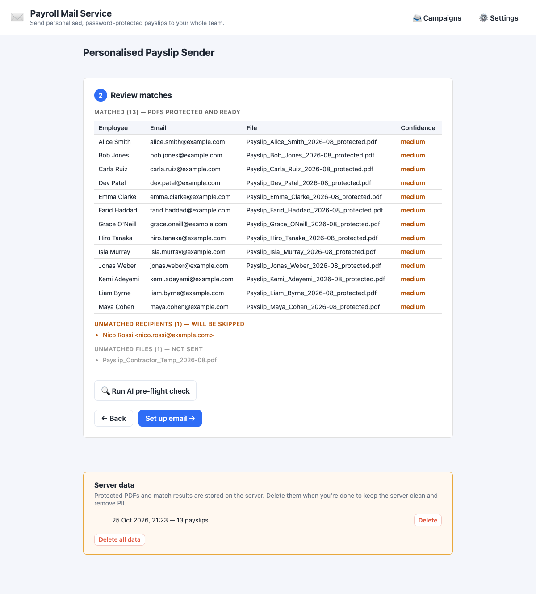
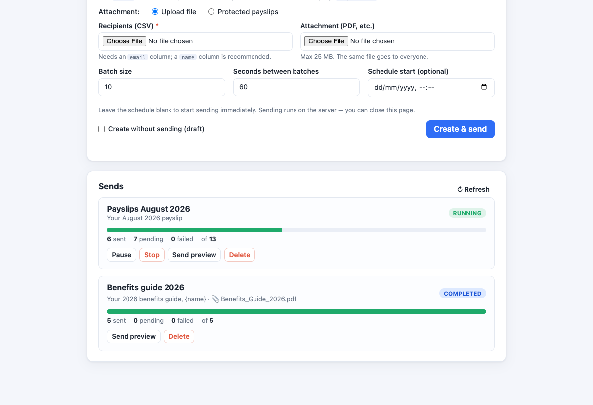
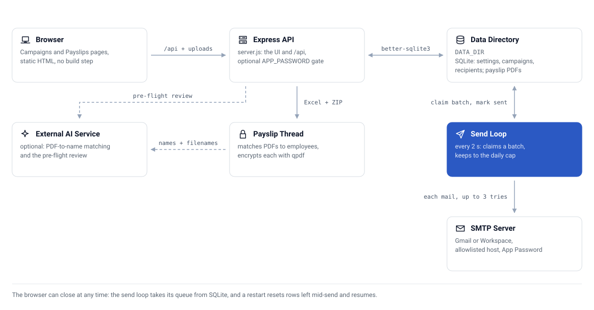

<div align="center">


# 💸 Payroll Mail Service

**Email each employee their own NI-locked payslip PDF, from your own server, in batches that stay under Gmail's daily limit**


[](https://github.com/CaputoDavide93/Payroll-Mail-Service/actions/workflows/ci.yml)

[Install](#install-in-3-steps) • [Features](#-features) • [Screenshots](#-screenshots) • [Docs](#-documentation) • [Contributing](#-contributing)

</div>

---

## ✨ Features

Upload an employee spreadsheet and a ZIP of payslip PDFs. The service pairs each PDF
with the right person, encrypts it with that person's NI number as the password, and
emails each employee only their own file, in batches slow enough for Gmail or Google
Workspace. You run it yourself, so payslips never pass through a third-party service.
It also sends ordinary personalised campaigns from a CSV.

### Why it exists

Payslip day usually means renaming PDFs, attaching them one by one, and hoping the
right file reached the right inbox. Pasting 600 recipients into a mail client gets
you throttled by your provider halfway through, and nobody can tell afterwards who
got what.

The service does the matching, the password protection and the pacing. You check one
review screen, press send, and close the browser. Sending carries on at the server and
resumes by itself after a restart.

| | Payroll Mail Service | Sending by hand from a mail client | A one-off script |
|---|---|---|---|
| One protected PDF per employee | Built in: match, encrypt with the NI number, attach | Manual, one message at a time | You write the matching and encryption |
| Keeps under the daily provider cap | Rolling 24-hour limit, set by you | You count | You write the counter |
| Survives a crash or restart | Yes: state lives in SQLite, unsent rows resume | No record of what went out | Only if you built it |
| Shows who got what | Sent, pending and failed per run, with retry | Sent folder | Only if you built it |
| Cleans up payroll data | Protected PDFs deleted after sending, runs purged after N days | Files stay in the mail client and on disk | Only if you built it |
| Where your data goes | Your server and your SMTP provider | Your mail provider | Wherever you put it |

The trade-off: you run and secure the server. It holds payroll data while a run is in
progress, so keep it on a machine you control, and put `APP_PASSWORD` and HTTPS in
front of it if anyone but you can reach it.

### Install in 3 steps

You need Docker 20+ (or Node.js 22 and `qpdf`) and a Gmail or Google Workspace
account with an [App Password](docs/setup.md#2-create-a-gmail-app-password).

1. **Get the code and start it:**

   ```bash
   git clone https://github.com/CaputoDavide93/Payroll-Mail-Service.git
   cd Payroll-Mail-Service
   docker compose up -d --build
   ```

2. **Open <http://localhost:3000>** and click **Settings**.
3. **Enter your Gmail address and App Password**, press **Send test**, then
   open **Payslips** and upload your Excel sheet and ZIP.

Your data survives `docker compose down` in the `mail-data` volume. Every screen is
walked through in [docs/setup.md](docs/setup.md). Without Docker: `npm ci && npm start`.

### What you get

| | Feature | What it does |
|---|---|---|
| 🔐 | Protected payslips | Each PDF is encrypted with 256-bit AES through `qpdf`, using the employee's NI number as the password. Each person receives only their own file |
| 🧠 | Name matching | Fuzzy matching pairs PDFs to employees by name. Optional AI matching and a pre-flight review catch odd pairings before any email goes out |
| 👀 | Review before sending | Matched, unmatched recipients and spare files are listed, so a missing payslip is visible before you press send |
| 🐢 | Batched sending | Set the batch size and the pause between batches. Defaults of 10 and 60 seconds spread 600 mails over about an hour |
| 🛟 | Daily cap | A rolling 24-hour limit keeps you inside Gmail and Workspace quotas |
| 🔁 | Crash-safe resume | SQLite holds every recipient's status. Rows claimed in a batch are marked first, so a crash cannot double-send |
| ⏰ | Scheduling | Start now or at a future time, read in your browser's timezone |
| 📊 | Live dashboard | Sent, pending and failed counts, a progress bar, pause, resume, stop and retry failed |
| 📇 | CSV campaigns | Any CSV with an `email` column. Other columns become `{placeholders}` in subject and body, with one shared attachment up to 25 MB |
| 🗑️ | Data retention | Protected PDFs are deleted once sent. Whole runs are purged after `PAYSLIP_RETENTION_DAYS` |
| 🛡️ | Locked down | Optional UI password, login throttling, and an SMTP host allowlist so the UI cannot point the app password at another server |
| ☁️ | Optional AWS deploy | Terraform for one EC2 instance with nginx, Let's Encrypt TLS and rollback on a failed health check |

---

## 📸 Screenshots

Demo data only: made-up employees at `example.com`, dummy PDFs and a local fake mail
server. Retake them with `make screenshots`.

<picture>
  <source media="(prefers-color-scheme: dark)" srcset="docs/assets/screenshots/payslips-review-dark.png">
  
</picture>

<picture>
  <source media="(prefers-color-scheme: dark)" srcset="docs/assets/screenshots/campaign-progress-dark.png">
  
</picture>

More screens, one per setup step, are in [docs/setup.md](docs/setup.md).

---

## 🗺️ Architecture

<picture>
  <source media="(prefers-color-scheme: dark)" srcset="docs/assets/architecture-dark.svg">
  
</picture>

One Node process serves the UI and the API, a second thread prepares payslips, and
one SQLite file holds all state. [docs/how-it-works.md](docs/how-it-works.md) has the details.

---

## 🧪 Supported and tested on

| Environment | Status |
|---|---|
| Node.js 22 on Ubuntu with `qpdf` | Tested by CI on every push and pull request |
| Node.js 22 on macOS (Apple silicon) with `qpdf` 12 | Test suite and screenshot script run here |
| Docker image on Docker Desktop for Mac (Apple silicon) | Image builds, the app answers on its port, `qpdf` is present |
| Node.js 26 | `npm ci` failed to build `better-sqlite3` here, so stay on 22 |
| Gmail and Google Workspace over SMTP (465, 587) | The design target, not re-tested against a live account in this review |
| AWS with Terraform | Not applied in this review: unverified |
| Windows, other Linux distributions, other mail providers | Unverified. Reports welcome, see [Contributing](#-contributing) |

---

## 📚 Documentation

| Guide | What it covers |
|---|---|
| [Setup](docs/setup.md) | Install, Gmail App Password, first campaign, first payslip run, with a screenshot per step |
| [Payslips](docs/payslips.md) | The payslip workflow, Excel format, retention, what is and is not stored |
| [Configuration](docs/configuration.md) | Every environment variable and its default |
| [Deployment](docs/deployment.md) | A Linux server with Docker, and the AWS Terraform stack |
| [Deliverability](docs/deliverability.md) | SPF, DKIM, DMARC and warm-up before a large send |
| [How it works](docs/how-it-works.md) | The send loop, atomic claims, retries, and known limits |
| [Troubleshooting](docs/troubleshooting.md) | Symptoms first, then fixes |
| [FAQ](docs/faq.md) | Short answers to common questions |
| [Security policy](SECURITY.md) | Data handling and how to report a vulnerability |

---

## 📁 Repo structure

```text
Payroll-Mail-Service/
├── server.js                  # 🎛️ Express app + API routes
├── src/                       # 🧠 SQLite, settings, mailer, worker, payslip pipeline
├── public/                    # 🖥️ web UI (campaigns + payslips pages)
├── tests/                     # 🧪 node --test suite
├── scripts/deploy.sh          # 🚀 build, push to ECR, roll the instance via SSM
├── tools/                     # 🔧 diagram, screenshot and brand-kit (icon, social preview) generators
├── config/                    # 📝 sample recipients CSV
├── docs/                      # 📚 guides, plus assets/ (diagrams, screenshots, brand)
├── terraform/                 # ☁️ AWS deployment (EC2, ECR, Route53, Secrets Manager)
├── .github/                   # 🤖 CI workflow, dependabot config and issue form
├── Dockerfile  docker-compose.yml  .dockerignore                  # 🐳 container
├── Makefile                   # ✅ make check, diagram, screenshots
├── .env.example               # ⚙️ every variable the code reads
├── package.json  package-lock.json
├── llms.txt                   # 🤖 plain-text summary for search and assistants
├── AGENTS.md                  # 🧭 instructions for contributors and coding agents
├── CONTRIBUTING.md  SECURITY.md  LICENSE
└── README.md
```

---

## 🛠️ Development

```bash
npm ci
make check        # npm test, diagram freshness, shellcheck
make screenshots  # retake docs/assets/screenshots (needs Python 3 and uv)
```

`npm test` needs `qpdf` on `PATH` for the payslip tests. `make check` also verifies
that every README and docs link resolves, every doc is linked from the index, and
every variable the code reads is in `.env.example`. CI runs the same checks in
[ci.yml](.github/workflows/ci.yml).

---

## 🔒 Security

Payslips carry payroll personal data. NI numbers are never stored or logged,
protected PDFs are deleted after sending, and `APP_PASSWORD` should always be set on
a server. See [SECURITY.md](SECURITY.md) for the data-handling policy and how to
report a vulnerability.

---

## 🤝 Contributing

Reports from environments not listed above are the most useful contribution. If you
run it on Windows, another Linux, another SMTP provider or a different Node version,
open an **Environment report** issue and say whether it worked. Attach your Node or
Docker version, the operating system, the SMTP provider type, and the output of
`docker logs payroll-mail-service` or the terminal. Remove NI numbers, real names,
email addresses and payslips first. Details are in [CONTRIBUTING.md](CONTRIBUTING.md).

---

## 📄 License

MIT. See [LICENSE](LICENSE).

---

<p align="center"><sub>Made with ❤️ by <a href="https://github.com/CaputoDavide93">Davide Caputo</a></sub></p>
