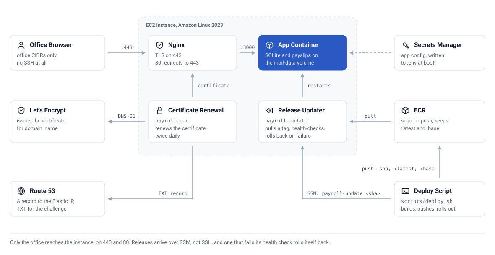

# 📦 Deployment

The app is one container. Run it anywhere Docker runs. Batches keep sending while your
laptop is closed, so a small always-on machine suits it better than a laptop.

> Always set `APP_PASSWORD` on any internet-facing server. Without it the API is open.

## Any Linux server

```bash
# 1. Install Docker
sudo apt-get update && sudo apt-get install -y docker.io git   # Debian or Ubuntu
# or: sudo dnf install -y docker git                           # Amazon Linux or RHEL
sudo systemctl enable --now docker
sudo usermod -aG docker $USER    # log out and in after this

# 2. Deploy
git clone https://github.com/CaputoDavide93/Payroll-Mail-Service.git payroll-mail
cd payroll-mail
cp .env.example .env
nano .env    # set SMTP_USER, SMTP_PASS, FROM_EMAIL, FROM_NAME, APP_PASSWORD
docker compose up -d --build
```

The simplest access is an SSH tunnel, which needs no public port:

```bash
ssh -L 3000:localhost:3000 user@<server-ip>
# then open http://localhost:3000 on your laptop
```

For team access, put Caddy or nginx in front on port 443 and set `TRUST_PROXY=1`.

## AWS with Terraform

`terraform/` builds one EC2 instance with an Elastic IP, reachable only from your office
address ranges, with TLS ended on the box.

<picture>
  <source media="(prefers-color-scheme: dark)" srcset="assets/aws-deployment-dark.svg">
  
</picture>

| Piece | What it does |
|---|---|
| `terraform/bootstrap/` | One-off S3 bucket and DynamoDB table for Terraform state, named after your account ID |
| `terraform/ec2.tf` | Instance, security group (443 and 80 from `office_cidrs` only, no SSH: use SSM Session Manager), Elastic IP |
| `terraform/ecr.tf` | ECR repo with scan on push. Keeps `:latest` and `:base`, expires untagged images after 7 days |
| `terraform/dns.tf` | A record for `domain_name` in `hosted_zone`, pointing at the Elastic IP |
| `terraform/secrets.tf` | App secret in Secrets Manager (Terraform never overwrites live values), IAM for ECR pull, SSM and the ACME TXT record |
| `terraform/user_data.sh.tpl` | Boot script: waits for secrets, writes `.env`, starts the app and nginx, installs `payroll-cert` (issue and renew, twice daily) and `payroll-update` (pull a tag, health-check, roll back on failure) |
| `scripts/deploy.sh` | Builds and pushes the image, then rolls the instance to the new git SHA over SSM. `scripts/deploy.sh --roll <tag>` rolls back |

```bash
cd terraform/bootstrap && terraform init && terraform apply && cd ..
# set the state bucket in main.tf (or: terraform init -backend-config="bucket=...")
cp terraform.tfvars.example terraform.tfvars    # office_cidrs, hosted_zone, domain_name
terraform init && terraform apply
../scripts/deploy.sh                            # build, push to ECR, roll the instance
```

Fill in the secret in Secrets Manager after the first apply. The instance waits at boot
until real values are present.

The instance is built to be stopped between pay runs: start it, wait about two minutes
(the certificate is renewed on boot if due), send, then stop it. Do not stop or redeploy
while a campaign is sending. The worker finishes its in-flight batch on shutdown, and
pending recipients resume on the next start.

This Terraform stack was not applied in the latest documentation review.
