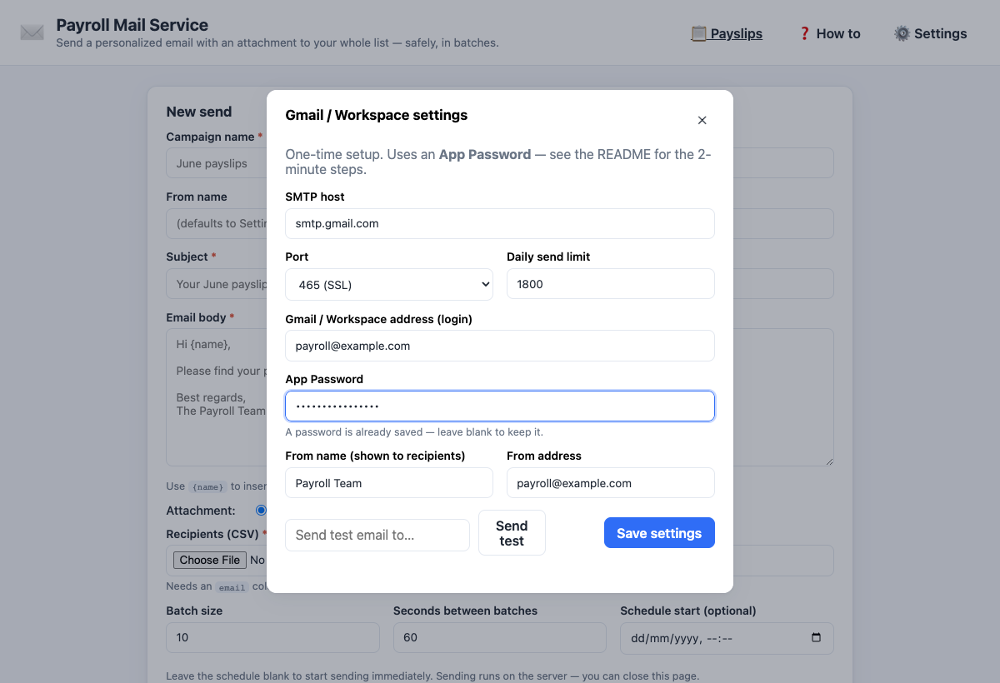
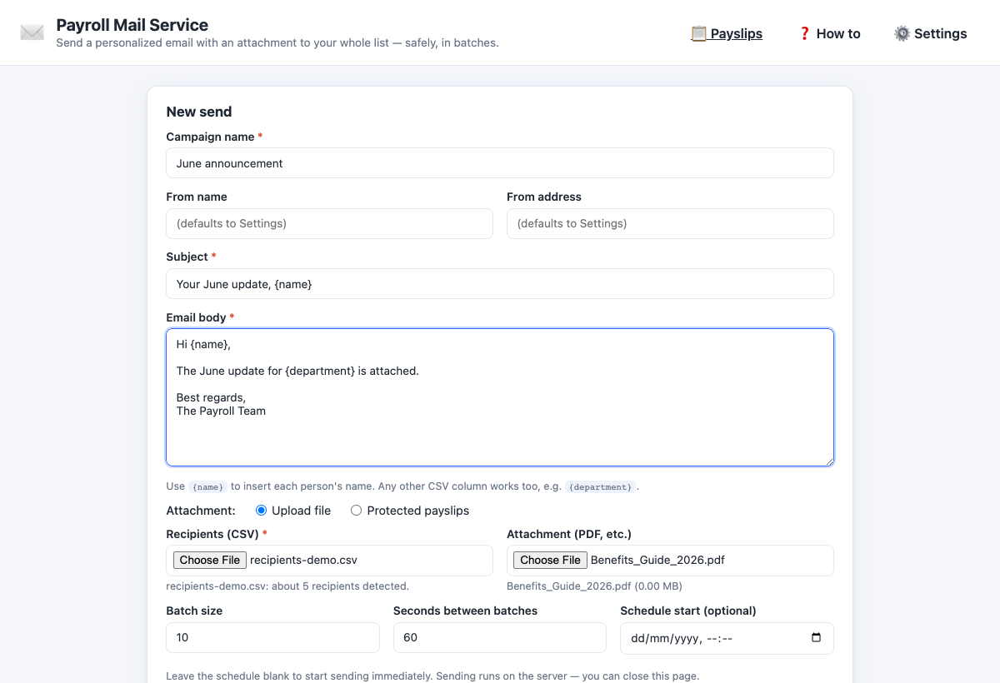
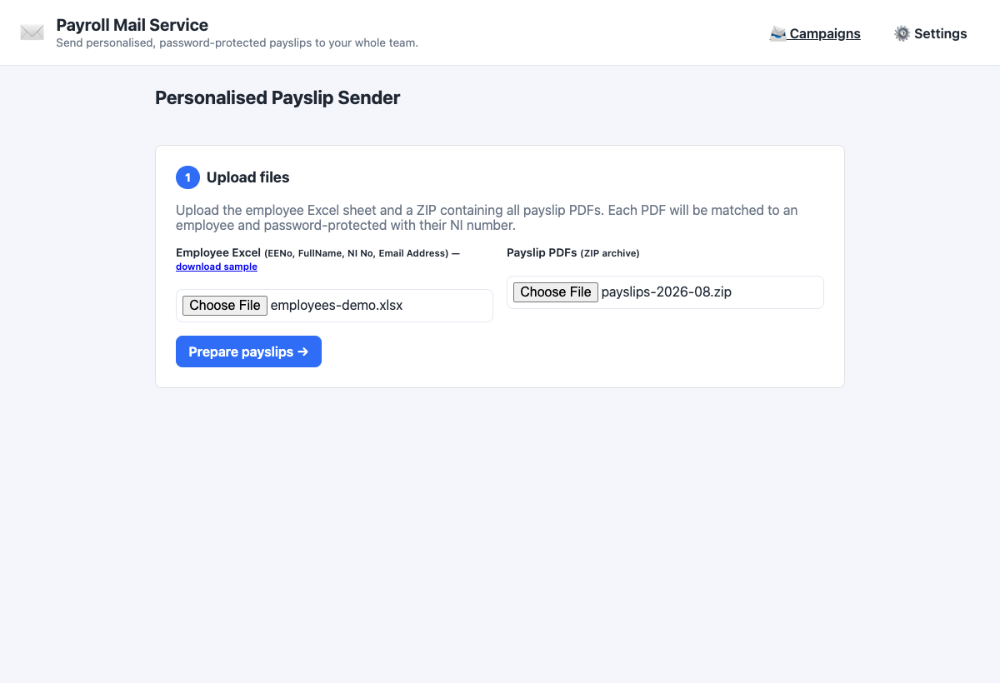
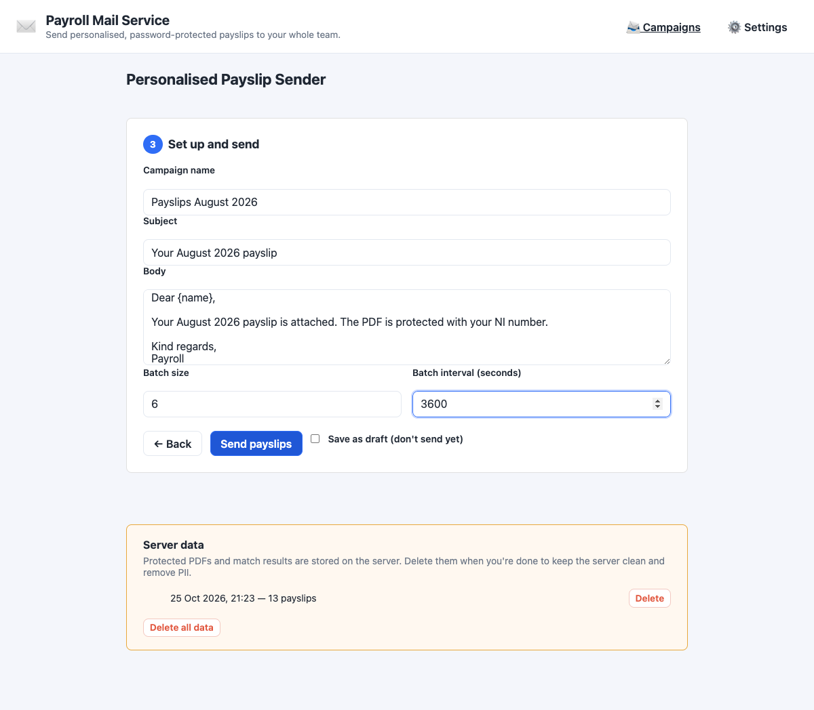

# 🚀 Setup

A walkthrough from an empty machine to a first payslip run. Allow about ten minutes,
plus the time Google takes to issue an App Password.

## Before you start

| You need | Notes |
|---|---|
| Docker 20+ | Recommended. Without it, use Node.js 22 and `qpdf` instead |
| A Gmail or Google Workspace account | 2-Step Verification must be on, to create an App Password |
| A sender address | Usually the same account. Workspace can use `smtp-relay.gmail.com` |
| Your payroll export | An Excel sheet and a ZIP of PDFs, see [payslips.md](payslips.md#excel-format) |

Gmail's sending limits are Google's to change. At the time of writing they are about
2,000 recipients a day on Google Workspace and about 500 on a free @gmail.com account.
Check Google's current figures and set `DAILY_LIMIT` below them.

## 1. Install and start

```bash
git clone https://github.com/CaputoDavide93/Payroll-Mail-Service.git
cd Payroll-Mail-Service
cp .env.example .env     # optional: you can configure everything in the web UI
docker compose up -d --build
```

Open <http://localhost:3000>. To stop it, run `docker compose down`. The database
and uploads live in the `mail-data` Docker volume, which `down` keeps. Only
`docker compose down -v` deletes it.

Without Docker:

```bash
npm ci
npm start        # needs qpdf on PATH for payslips: brew install qpdf / apt install qpdf
```

`npm start` does not read `.env`. Export variables in your shell instead.

## 2. Create a Gmail App Password

App Passwords need 2-Step Verification on your Google account.

1. Turn on 2-Step Verification: <https://myaccount.google.com/signinoptions/twosv>
2. Create an App Password: <https://myaccount.google.com/apppasswords>
3. Name it `Payroll Mail Service` and copy the 16-character password.

## 3. Enter your mail settings

Click **Settings** in the top bar and fill in the SMTP host (`smtp.gmail.com`), the
port (`465`), your address, the App Password and the sender name and address. Press
**Save settings**, then **Send test** to confirm the connection before a real run.

<picture>
  <source media="(prefers-color-scheme: dark)" srcset="assets/screenshots/settings-dark.png">
  
</picture>

## 4. Send a first campaign (optional)

A campaign sends one message to a CSV of recipients. Fill in the name, subject and
body, upload the CSV and an optional attachment, and press **Create & send**. Use
`{name}` or any CSV column as a placeholder. The [sample CSV](../config/sample-recipients.example.csv)
shows the shape.

<picture>
  <source media="(prefers-color-scheme: dark)" srcset="assets/screenshots/campaign-new-dark.png">
  
</picture>

Use **Send preview** on any campaign to email yourself the rendered message with its
real attachment before it goes to everyone.

## 5. Run a payslip batch

Open **Payslips** in the top bar. Step 1 takes the employee Excel sheet and the ZIP
of PDFs.

<picture>
  <source media="(prefers-color-scheme: dark)" srcset="assets/screenshots/payslips-upload-dark.png">
  
</picture>

Press **Prepare payslips**. The service matches each PDF to an employee, encrypts it
with that employee's NI number, and shows the result. Read this screen: employees
without a PDF are skipped, and spare files are not sent.

<picture>
  <source media="(prefers-color-scheme: dark)" srcset="assets/screenshots/payslips-review-dark.png">
  
</picture>

Press **Set up email**, write the subject and body, choose the batch size and the
pause between batches, and press **Send payslips**. Tick **Save as draft** to create
the run without sending.

<picture>
  <source media="(prefers-color-scheme: dark)" srcset="assets/screenshots/payslips-send-dark.png">
  
</picture>

## 6. Watch it send

The home page lists every send. You can pause, resume, stop, retry failed
recipients, or close the browser: the server keeps going.

<picture>
  <source media="(prefers-color-scheme: dark)" srcset="assets/screenshots/campaign-progress-dark.png">
  
</picture>

## 7. Clean up

Protected PDFs are deleted as each one is sent, and whole runs expire after
`PAYSLIP_RETENTION_DAYS` (7 by default). The Payslips page has a **Server data**
panel to delete runs by hand.

## Next

- Put the app behind a password and HTTPS: [deployment.md](deployment.md)
- Check your domain's SPF, DKIM and DMARC: [deliverability.md](deliverability.md)
- Something went wrong: [troubleshooting.md](troubleshooting.md)
